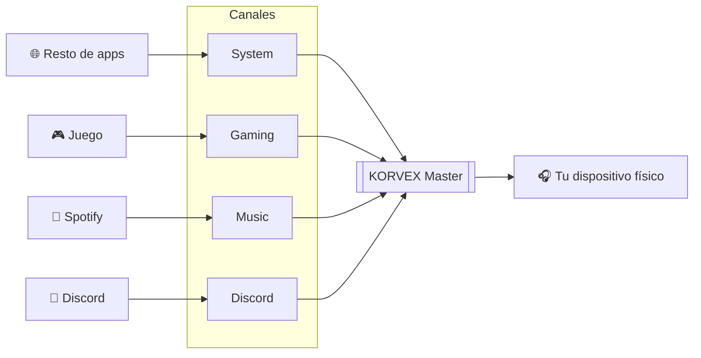

<div align="center">


# KORVEX Audio Console

**Mezclador de audio virtual para Linux, pensado para streaming.**
Crea canales, asigna cada aplicación a uno y controla su volumen por separado,<br>
sin tocar la configuración de audio de tu sistema.

[](../../releases/latest)
[](#-instalación)
[](#-requisitos)
[](https://pypi.org/project/PyQt6/)
[](LICENSE)

[**Descargar**](../../releases/latest) · [Instalación](#-instalación) · [Uso](#-uso) · [Cómo funciona](#-cómo-funciona) · [Problemas](#-problemas-frecuentes)

</div>

---

## ✨ Características

<table>
<tr>
<td width="50%" valign="top">

### 🎛️ Mezcla
- **Canales virtuales ilimitados**: System, Gaming, Music, Discord…
- **Fader y mute independientes** por canal
- **Vúmetros en tiempo real** leídos del propio canal
- **Renombrar y borrar** canales al vuelo

</td>
<td width="50%" valign="top">

### 🧭 Enrutado
- **Cada app a su canal** desde un desplegable
- **Se recuerda la asignación**: la app vuelve a su canal cada vez que se abre
- **Salida maestra** hacia cualquier dispositivo físico
- **Filtra streams internos** (loopbacks, speech-dispatcher…)

</td>
</tr>
<tr>
<td width="50%" valign="top">

### 🛡️ Fiable
- **Reconexión automática** si PipeWire/PulseAudio se reinicia
- **Deja el sistema como estaba** al cerrar
- **Configuración a prueba de cortes** (guardado atómico + copia si se corrompe)

</td>
<td width="50%" valign="top">

### 🎨 Cómoda
- Interfaz oscura moderna en **PyQt6**
- **Iconos de cada app** tomados del tema del sistema
- **Arranque con el sistema** activable desde Ajustes

</td>
</tr>
</table>

---

## 📥 Instalación

### Debian / Ubuntu (recomendado)

Descarga el `.deb` desde [**Releases**](../../releases/latest) e instálalo:

```bash
sudo apt install ./korvex-audio-console_1.1.0_all.deb
```

Listo: aparece en el menú de aplicaciones con su icono y `apt` instala todas las dependencias.

> [!TIP]
> Usa `apt install ./archivo.deb` (con el `./`) en lugar de `dpkg -i`, así `apt` resuelve las dependencias por ti.

<details>
<summary><b>Otras distribuciones (Arch, Fedora, openSUSE…)</b></summary>

<br>

Desde el código fuente:

```bash
git clone https://github.com/mikicolmena/KORVEX-Audio-Console.git
cd KORVEX-Audio-Console
pip3 install --user -r requirements.txt
python3 korvexaudioconsole.py
```

Necesitas además `pactl` y `parec` (paquete `pulseaudio-utils` o `libpulse` según la distro).

</details>

<details>
<summary><b>Construir el .deb tú mismo</b></summary>

<br>

```bash
git clone https://github.com/mikicolmena/KORVEX-Audio-Console.git
cd KORVEX-Audio-Console
./build_deb.sh
sudo apt install ./korvex-audio-console_1.1.0_all.deb
```

</details>

### 📋 Requisitos

| Componente | Versión | Para qué |
|:--|:--|:--|
| Python | ≥ 3.10 | |
| PyQt6 | ≥ 6.4 | Interfaz |
| pulsectl | 23.5 – 24.x | Control de PipeWire/PulseAudio |
| `pactl`, `parec` | — | Enrutado y vúmetros (`pulseaudio-utils`) |
| PipeWire o PulseAudio | — | Servidor de audio |

---

## 🚀 Uso

| Paso | Dónde | Qué hacer |
|:--:|:--|:--|
| **1** | 🎧 **Salida Maestra** | Elige tu dispositivo físico: auriculares, altavoces, interfaz USB… *Solo una vez.* |
| **2** | 🎚️ **Mezclador** | Crea los canales que quieras con **+ Añadir Canal**. |
| **3** | 🎛️ **Aplicaciones** | Asigna cada app a un canal desde el desplegable. |
| **4** | 🎚️ **Mezclador** | Ajusta el volumen o mutea cada canal por separado. |

> [!NOTE]
> - El fader de un canal controla **solo** las apps de ese canal, y su MUTE silencia **solo** ese canal.
> - Las asignaciones se guardan solas y se restauran al abrir la app o al reiniciar el PC.
> - Las apps que no están en ningún canal aparecen como **«Fuera del mezclador»**.

---

## 🔀 Cómo funciona

KORVEX crea dispositivos virtuales (*null sinks*) y los encadena hasta tu salida real:



Al cerrar la app, todo vuelve a tu dispositivo original y los dispositivos virtuales se eliminan. La configuración se guarda en `~/.config/korvex-audio-console/config.json`.

---

## 🐛 Problemas frecuentes

<details>
<summary><b>Los vúmetros no se mueven</b></summary>
<br>
Comprueba que <code>parec</code> está instalado: <code>sudo apt install pulseaudio-utils</code>
</details>

<details>
<summary><b>La app no ve mis canales o no arranca</b></summary>
<br>
Asegúrate de que PipeWire/PulseAudio está en marcha (<code>pactl info</code>) y de que tu usuario tiene acceso al socket de audio.
</details>

<details>
<summary><b>Aparece un stream interno que no es una app</b></summary>
<br>
Los habituales ya se filtran. Si ves alguno más, <a href="../../issues">abre un issue</a> con su nombre.
</details>

<details>
<summary><b>No se inicia al arrancar el PC</b></summary>
<br>
Actívalo en <b>⚙️ Ajustes → Iniciar con el sistema</b>.
</details>

<details>
<summary><b>Algo raro pasa y quiero ver qué ocurre</b></summary>
<br>
Lanza la app desde una terminal con <code>korvex-audio-console</code>: los errores salen con el prefijo <code>[Korvex/…]</code>.
</details>

---

## 📂 Estructura

```
KORVEX-Audio-Console/
├── korvexaudioconsole.py   # La aplicación completa
├── build_deb.sh          # Genera el paquete .deb
├── requirements.txt      # Dependencias pip
├── KorvexLogo-*.png      # Iconos
└── LICENSE
```

---

## 🤝 Contribuir

¡Las contribuciones son bienvenidas! Para cambios grandes, abre antes un [issue](../../issues) y lo hablamos.

```bash
git checkout -b feature/mi-mejora
git commit -m "feat: descripción"
git push origin feature/mi-mejora
```

…y abre un **Pull Request**.

---

<div align="center">

Parte del ecosistema **KORVEX** · Licencia [MIT](LICENSE)

Hecho con ❤️ por [@mikicolmena](https://github.com/mikicolmena)

</div>
